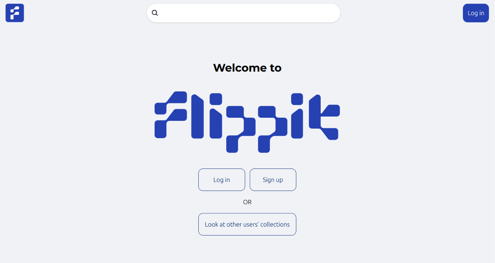
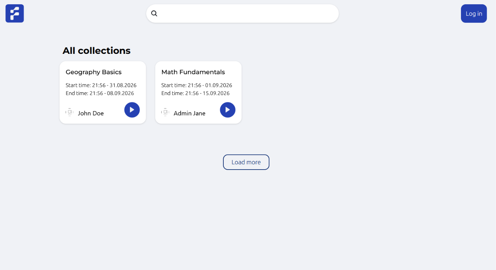
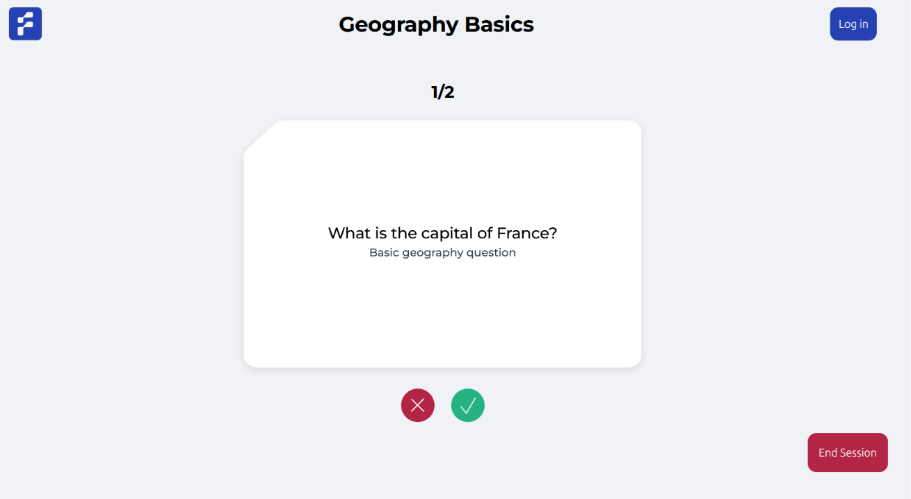

## Overview
Flash card application.

## Folder structure
```txt
Flippit.sln
README.md
src/
├── Api/
│   ├── Flippit.Api.App/                    # Web API application
│   ├── Flippit.Api.App.EndToEndTests/      # End-to-end tests for the API
│   ├── Flippit.Api.BL/                     # Business logic layer
│   ├── Flippit.Api.BL.UnitTests/           # Unit tests for business logic
│   ├── Flippit.Api.DAL.Common/             # Common data access layer components
│   ├── Flippit.Api.DAL.EF/                 # Entity Framework data access layer
│   ├── Flippit.Api.DAL.IntegrationTests/   # Integration tests for data access
│   ├── Flippit.Api.DAL.Memory/             # In-memory data access layer
├── Common/
│   ├── Flippit.Common/                     # Shared utilities and enums
│   ├── Flippit.Common.BL/                  # Shared business logic
│   ├── Flippit.Common.Models/              # Shared data models
```
## Screenshots



